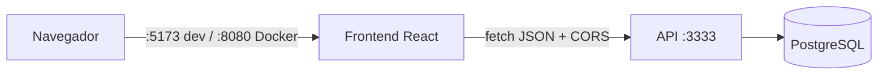

# 🏥 Agendamento Médico — Frontend

[](https://github.com/lfguimara/agendamento-medico-front/actions/workflows/ci.yml)

Interface web do sistema de agendamento médico. Consome a API do repositório [agendamento-medico](https://github.com/lfguimara/agendamento-medico). Projeto da disciplina de DevOps.

## Funcionalidades

| Tela | O que faz |
|---|---|
| **Consultas** | Agendar (paciente, médico, data/hora), listar com filtros de status e médico, concluir e cancelar |
| **Pacientes** | Cadastrar, editar, excluir e listar |
| **Médicos** | Cadastrar, editar, excluir e listar, com filtro por especialidade |

As regras de negócio ficam no backend. O frontend mostra as mensagens de erro da API, inclusive os campos inválidos nos erros de validação.

## Stack

| Camada | Tecnologia |
|---|---|
| UI | React 19 + TypeScript |
| Build | Vite 8 |
| Estilo | Tailwind CSS 4 |
| Lint | oxlint |
| Servidor (produção) | nginx (imagem `nginx-unprivileged`) |
| CI/CD | GitHub Actions + GitHub Container Registry (GHCR) |

## Arquitetura

```
src/
├── main.tsx              # ponto de entrada
├── App.tsx               # cabeçalho e navegação entre abas
├── index.css             # importa o Tailwind
├── api/
│   ├── client.ts         # fetch com URL base e tratamento de erros da API
│   ├── recursos.ts       # funções por recurso (pacientes, médicos, consultas)
│   └── types.ts          # tipos que espelham as respostas da API
├── hooks/useDados.ts     # carrega dados da API (loading, erro, recarregar)
├── components/ui.tsx     # componentes visuais reaproveitáveis
└── pages/                # uma página por recurso
```



## Como rodar

O frontend precisa da **API rodando** em `http://localhost:3333`. No repositório do backend:

```bash
docker compose up -d --build
```

### Opção 1: desenvolvimento (hot reload)

Pré-requisito: Node.js 24+.

```bash
npm install
npm run dev        # http://localhost:5173
```

### Opção 2: Docker

```bash
docker build -t agendamento-medico-front .
docker run -d --name agendamento-front -p 8080:8080 agendamento-medico-front
# http://localhost:8080
```

> A API libera por padrão as origens `http://localhost:5173` e `http://localhost:8080` (variável `CORS_ORIGIN` do backend). Se usar outra porta ou domínio, adicione a origem lá.

## Variáveis de ambiente

| Variável | Descrição | Padrão |
|---|---|---|
| `VITE_API_URL` | URL base da API | `http://localhost:3333` |

O Vite **embute** essa URL no JavaScript durante o build. Por isso:

- **Em dev**: copie `.env.example` para `.env` e ajuste
- **No Docker**: passe na hora do build, com `docker build --build-arg VITE_API_URL=https://api.exemplo.com .`

## Docker

O `Dockerfile` é **multi-stage**:

| Estágio | Conteúdo |
|---|---|
| `build` | Node.js 24: `npm ci` e `npm run build`, que gera `dist/` |
| `runtime` | Só o nginx com os arquivos estáticos (~80 MB) |

Configuração do nginx (`nginx.conf`):

- **Usuário sem privilégios**: imagem `nginx-unprivileged`, porta 8080
- **`/health`**: endpoint para o `HEALTHCHECK` do Docker
- **Cache**: arquivos em `/assets/` (com hash no nome) ficam em cache por 1 ano, e o `index.html` nunca fica em cache
- **gzip** para CSS, JS, JSON e SVG
- **Fallback de SPA**: qualquer rota desconhecida devolve o `index.html`

## CI/CD

O pipeline fica em [`.github/workflows/ci.yml`](.github/workflows/ci.yml) e segue o mesmo modelo do backend.

| Job | Quando roda | Etapas |
|---|---|---|
| `ci` (Validar aplicação) | Todo PR e push na `main` | `npm ci` → `npm audit` → lint → `tsc` + build → `docker build` |
| `publish` (Publicar imagem) | Só em push na `main`, depois do `ci` passar | Build e push para `ghcr.io/lfguimara/agendamento-medico-front`, com as tags `latest` e `sha-<commit>` |

## Scripts

| Comando | Descrição |
|---|---|
| `npm run dev` | Servidor de desenvolvimento com hot reload |
| `npm run build` | Verifica tipos (`tsc -b`) e gera `dist/` |
| `npm run preview` | Serve o build localmente |
| `npm run lint` | Lint com oxlint |
